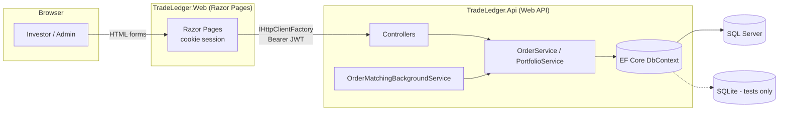

# TradeLedger

[](https://github.com/edu-tech220/tradeledger/actions/workflows/ci.yml)


A personal brokerage **order execution and portfolio ledger** platform. Investors buy and sell
simulated securities with real buying-power checks, FIFO cost-basis lots and realized P&L — built
as two independent ASP.NET Core 8 microservices (a Web API and a Razor Pages frontend) talking
over HTTP, backed by SQL Server in production and SQLite in tests.

## What it solves

Trading a portfolio sounds simple — "buy some shares, sell some shares" — but keeping the ledger
honest under concurrency and odd order types is where it gets interesting:

- Can you actually afford this buy, once you account for cash already reserved by *other* pending
  limit orders?
- Which specific lot of shares did you sell, and at what cost, so the realized gain/loss is
  correct for tax purposes?
- What happens when two requests try to spend the same dollar, or sell the same share, at the
  same time?
- A limit order that doesn't cross the market yet shouldn't just vanish — it has to sit there and
  still be honored later if the price moves.

TradeLedger answers all four with a small, deliberately real domain model instead of a toy CRUD
API.

## Business rules

- **Buying power, not just cash.** A pending limit buy reserves funds against the account's cash
  balance; a new order can't spend money that's already earmarked by another pending order.
  Likewise, a pending limit sell reserves shares out of the holdings available to sell.
- **Market vs. limit execution.** Market orders execute immediately at the security's current
  price or get rejected on the spot. Limit orders only cross when the market price already
  satisfies the limit; otherwise they stay `Pending` until a price update makes them eligible.
- **FIFO cost-basis lots.** Every buy creates a lot (quantity, unit cost, purchase date). A sell
  consumes the oldest open lots first and the trade's realized P&L is `proceeds − cost basis of
  the lots actually consumed` — not a simple average.
- **Portable optimistic concurrency.** `Account` and `Lot` each carry an application-managed
  version token (not a database-generated rowversion, so the exact same code path works on SQL
  Server and SQLite). Every mutation opens a fresh `DbContext` per retry attempt and replays the
  whole read-check-write cycle against a clean snapshot on conflict — see
  `OrderService.TryFillWithRetryAsync`.
- **No stranded Market orders.** A Limit order that can't fill yet safely waits — the market might
  still move its way. A Market order has no such later chance: if it loses a concurrency race for
  funds or shares, it is rejected immediately instead of being left `Pending` forever.
- **A background sweep as a safety net.** `OrderMatchingBackgroundService` periodically re-checks
  every pending limit order, so one still fills after an admin price update even without a new
  request arriving.
- **Role-gated price updates.** Only `Admin` can move a security's price; `Investor` accounts can
  only trade.

## Architecture



- **TradeLedger.Web** never talks to the database directly — it's a thin HTML client over the
  API, using `IHttpClientFactory` and a cookie that carries the JWT issued at login.
- **TradeLedger.Api** owns all business rules and data access. `TradeLedger.Web` and
  `TradeLedger.Api` are deployed and scaled independently; they only share an HTTP contract.

## Technical decisions

| Decision | Why |
|---|---|
| Two separate ASP.NET Core projects instead of one | Matches the required microservices split: a UI-only frontend and an API that owns the domain, independently deployable and scalable. |
| Application-managed concurrency token instead of a SQL Server `rowversion` | `rowversion` has no SQLite equivalent. A plain incrementing `uint` column behaves identically under both providers, so the test suite exercises the *real* concurrency path, not a stand-in. |
| `IDbContextFactory<T>` instead of a single scoped `DbContext` in the trading path | Every retry attempt after a concurrency conflict needs a context with no stale tracked entities. A factory makes "open a fresh context per attempt" the natural shape of the code. |
| `EnsureCreated()` for SQLite, `Migrate()` for SQL Server | The scaffolded migrations bake in SQL-Server-only column types (e.g. `varbinary(max)`) and can't run as-is against SQLite. Tests build the schema straight from the current model instead. |
| Cookie-based session on the frontend, Bearer JWT on the API | The browser never sees the token directly; a `DelegatingHandler` reads it from the authenticated cookie principal and attaches it to outgoing API calls. |
| FIFO lots instead of a single average-cost balance | Needed for correct realized P&L per sale — an average-cost shortcut can't answer "how much did *this* sale actually make." |

## Endpoints

| Method | Route | Auth | Description |
|---|---|---|---|
| POST | `/api/auth/register` | Public (rate-limited) | Create an Investor account with $10,000 starting cash. |
| POST | `/api/auth/login` | Public (rate-limited) | Exchange credentials for a JWT. |
| GET | `/api/securities` | Public | List tradable securities and current prices. |
| GET | `/api/securities/{symbol}` | Public | Get one security. |
| PUT | `/api/securities/{symbol}/price` | Admin | Update a security's current price. |
| GET | `/api/accounts/me` | Authenticated | Cash balance and available buying power. |
| GET | `/api/accounts/me/positions` | Authenticated | Open positions with average cost and unrealized P&L. |
| GET | `/api/accounts/me/trades` | Authenticated | Paginated trade history with realized P&L. |
| POST | `/api/orders` | Authenticated | Place a market or limit buy/sell order. |
| GET | `/api/orders` | Authenticated | Paginated order history, optionally filtered by status. |
| GET | `/api/orders/{id}` | Authenticated | Get one of the caller's own orders. |
| POST | `/api/orders/{id}/cancel` | Authenticated | Cancel a Pending order. |
| GET | `/api/admin/accounts` | Admin | Paginated view across every account. |

Errors use [RFC 7807](https://www.rfc-editor.org/rfc/rfc9457) `ProblemDetails` (404/409/422/400 as
appropriate), and the API exposes Swagger UI at `/swagger` in Development.

## Demo accounts

Seeded automatically on startup:

| Username | Password | Role |
|---|---|---|
| `admin` | `Admin#12345` | Admin — can update security prices and view all accounts |
| `investor` | `Investor#12345` | Investor — $10,000 starting cash |

## Running it

### With Docker Compose (API + Web + SQL Server)

```bash
docker compose up --build
```

- Web: http://localhost:5230
- API + Swagger: http://localhost:5165/swagger

### With `dotnet run` (no Docker)

You need a reachable SQL Server for the API (for example `docker compose up sqlserver`, or any
local instance matching the connection string in `src/TradeLedger.Api/appsettings.json`).

```bash
dotnet run --project src/TradeLedger.Api   # listens on http://localhost:5165
dotnet run --project src/TradeLedger.Web   # listens on http://localhost:5230, already points at the API above
```

## Testing

```bash
dotnet test
```

The test suite runs entirely against an in-memory SQLite database through
`WebApplicationFactory<Program>` — no SQL Server, no Docker, no external services. It covers auth,
role-gated endpoints, buying-power/holdings rejections, market vs. limit fills, FIFO realized P&L,
pagination, the limit-order matching sweep, and concurrent orders racing for the same cash or
shares.

## Solution layout

```
src/TradeLedger.Api/      ASP.NET Core Web API — domain, EF Core, JWT auth, background sweep
src/TradeLedger.Web/      ASP.NET Core Razor Pages — HTML frontend, cookie session, IHttpClientFactory
tests/TradeLedger.Api.Tests/   xUnit integration + unit tests
```
